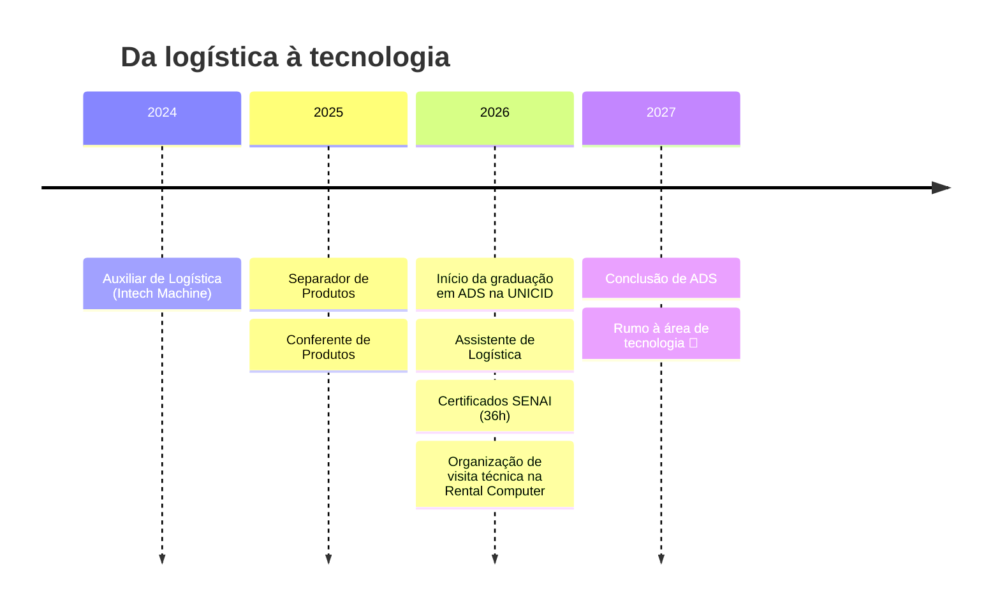

<!-- ==================== BANNER ==================== -->


<p align="center">
  <a href="https://git.io/typing-svg">
    
  </a>
</p>

<p align="center">
  <a href="https://www.linkedin.com/in/gabriel-de-souza-aabba7435/"></a>
  <a href="mailto:gabrieldesouza1830@gmail.com"></a>
  
  
</p>

---

## 🙋‍♂️ Sobre mim

Sou estudante de **Análise e Desenvolvimento de Sistemas** na **UNICID** (previsão de conclusão: dez/2027) e trabalho como **Assistente de Logística**. Vim da logística para a tecnologia, e o que mais me motiva é **criar soluções que facilitem o trabalho das pessoas**: automatizar tarefas repetitivas, organizar processos e transformar dados em decisões.

Meu objetivo é conquistar um **estágio ou posição efetiva em tecnologia** e, no futuro, atuar com **cibersegurança**, desenvolvendo sistemas que protejam a segurança e a privacidade das pessoas. 🔐

```javascript
const gabriel = {
  local: "Itaquaquecetuba - SP 🇧🇷",
  formacao: "Análise e Desenvolvimento de Sistemas @ UNICID (2026 - 2027)",
  trabalhoAtual: "Assistente de Logística @ Intech Machine",
  estudandoAgora: ["Python", "JavaScript", "Java", "C#", "SQL"],
  interesses: ["Desenvolvimento", "Banco de Dados", "Análise de Dados", "Cibersegurança"],
  procurando: "Estágio em desenvolvimento / tecnologia 🚀",
  idiomas: ["Português (nativo)", "Inglês (leitura e escrita)"],
  lema: "Errar faz parte do processo. O importante é saber onde e por que errei.",
};
```

---

## 🔭 O que estou fazendo atualmente

- 🎓 Cursando **ADS na UNICID** e reforçando a base em lógica de programação
- 📦 Atuando como **Assistente de Logística**, aplicando análise de dados e organização de processos no dia a dia
- 🐍 Aprofundando meus conhecimentos em **Python, JavaScript e SQL** rumo ao nível avançado
- 🛡️ Estudando **LGPD, privacidade e proteção de dados**, primeiros passos em direção à cibersegurança
- 🗂️ Organizando meus repositórios com READMEs completos e publicando novos projetos
- ✍️ Compartilhando meus estudos e experiências no [LinkedIn](https://www.linkedin.com/in/gabriel-de-souza-aabba7435/)

---

## 🛠️ Tecnologias e ferramentas

<p align="center">
  <a href="https://skillicons.dev">
    
  </a>
</p>

| Área | O que já uso | O que estou estudando |
|:---|:---|:---|
| 💻 **Desenvolvimento** | HTML, CSS, JavaScript, Python | Java, C#, desenvolvimento de interfaces |
| 🗄️ **Banco de Dados** | SQL | Modelagem e consultas avançadas |
| 📊 **Análise de Dados** | Planilhas, análise de dados logísticos | Python para dados |
| 🔐 **Cibersegurança** | LGPD e proteção de dados | Segurança da informação *(meta futura)* |
| 🔧 **Ferramentas** | Git, GitHub, VS Code | — |

---

## 🧭 Minha trajetória



<details>
<summary><b>💼 Ver experiência profissional em detalhes</b></summary>
<br/>

| Cargo | Empresa | Período |
|:---|:---|:---|
| 📋 **Assistente de Logística** | Intech Machine | abr/2026 – atual |
| ✅ Conferente de Produtos | Intech Machine | jul/2025 – mar/2026 |
| 📦 Separador de Produtos | Intech Machine | abr/2025 – jun/2025 |
| 🚚 Auxiliar de Logística | Intech Machine | ago/2024 – mar/2025 |

Na logística atuo com **sistemas logísticos, transporte, faturamento, expedição, almoxarifado, marketplace, análise de dados e apoio à liderança**. Essa vivência me deu uma visão prática de como a tecnologia pode tornar processos mais ágeis e menos repetitivos.

</details>

---

## 📜 Certificados

<details>
<summary><b>🏅 Ver certificados (36 horas · SENAI-SP)</b></summary>
<br/>

| Curso | Instituição | Carga horária |
|:---|:---|:---:|
| 💡 Competência Transversal: Lógica de Programação | SENAI-SP | 14h |
| 🖥️ Competência Transversal: Tecnologia da Informação e Comunicação | SENAI-SP | 14h |
| 🔒 Privacidade e Proteção de Dados (LGPD) | SENAI-SP | 4h |
| ⚖️ Regulamentação da LGPD e Atuação da ANPD | SENAI-SP | 4h |
| | **Total** | **36h** |

Também participei dos **três dias do WECTI** (semana de tecnologia da UNICID).

</details>

---

## 🧠 Meu jeito de trabalhar

<details>
<summary><b>Ver meu perfil comportamental (DISC)</b></summary>
<br/>

Meu perfil combina **Dominância** e **Estabilidade**, com traços fortes de **Conformidade** e **Influência**:

- ⚡ **Ação com cautela:** decido rápido quando é preciso, mas analiso as informações antes de decisões importantes
- 🎯 **Orientado a objetivos:** gosto de metas claras e de ver o progresso acontecendo
- 🤝 **Cooperação acima de competição:** valorizo confiança, respeito e um bom clima na equipe
- 🧭 **Liderança situacional:** assumo a direção quando o grupo está sem rumo e apoio nos bastidores quando o caminho já está definido
- 🗣️ **Comunicação direta e respeitosa:** prefiro ir ao ponto, com critérios claros
- 🔍 **Foco em qualidade:** gosto de melhorar processos para evitar erros recorrentes

</details>

<details>
<summary><b>🏢 Visita técnica que organizei: Rental Computer</b></summary>
<br/>

Organizei uma visita técnica para **11 alunos de ADS** na **Rental Computer**, empresa que fornece hardware para outras empresas. Fomos recebidos pela CEO, que nos apresentou as equipes de logística, área computacional e operação.

A visita mudou minha visão de TI: por trás de cada tela existe uma operação de cuidado, manutenção e atendimento. Duas frases ficaram comigo:

> *"TI sempre terá clientes exigentes."*
>
> *"Independentemente da situação, sempre se esforce para agradar os seus clientes."*

</details>

---

## 🎯 Metas e roadmap

- [x] Atualizar currículo, LinkedIn e GitHub
- [x] Ultrapassar 500 conexões no LinkedIn *(748+ conexões)*
- [x] Concluir 30h de cursos complementares *(36h concluídas)*
- [x] Organizar uma visita técnica com a turma
- [ ] Concluir e melhorar meu portfólio pessoal · *dez/2026*
- [ ] Levar minhas linguagens de programação ao nível avançado · *fev/2027*
- [ ] Publicar mais projetos com READMEs completos
- [ ] Conquistar meu primeiro estágio em tecnologia 🚀
- [ ] Iniciar a jornada em cibersegurança 🔐
- [ ] Concluir a graduação em ADS · *dez/2027*

---

## 🐍 Minhas contribuições

<picture>
  <source media="(prefers-color-scheme: dark)" srcset="https://raw.githubusercontent.com/gabrieldesouza1830-cell/gabrieldesouza1830-cell/output/github-contribution-grid-snake-dark.svg">
  <source media="(prefers-color-scheme: light)" srcset="https://raw.githubusercontent.com/gabrieldesouza1830-cell/gabrieldesouza1830-cell/output/github-contribution-grid-snake.svg">
  
</picture>

---

## 🤝 Vamos conversar?

Estou aberto a **oportunidades de estágio**, trocas de conhecimento e projetos em equipe. Se quiser falar sobre tecnologia, dados, logística ou segurança da informação, me chama! 😄

<p align="center">
  <a href="https://www.linkedin.com/in/gabriel-de-souza-aabba7435/"></a>
  <a href="mailto:gabrieldesouza1830@gmail.com"></a>
</p>

<p align="center">
  <i>"Você não vai conhecer alguém totalmente sem conviver com ela constantemente."</i>
</p>


